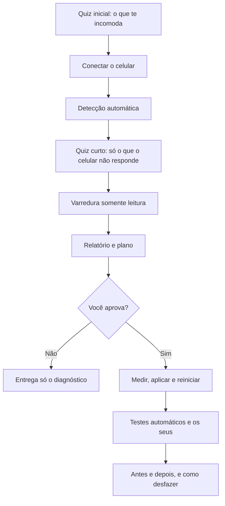

# Debloat Galaxy

**Faça um check-up e uma limpeza segura no seu Android, conversando com uma IA.** Você responde a um quiz, aprova o plano e acompanha. Ela faz o resto pelo cabo USB, sem root e sem apagar suas coisas.

Feito e testado em um Galaxy S25+ com Android 17 e One UI 9. Funciona melhor em Samsung, mas o roteiro serve para outros Android.

> [!IMPORTANT]
> **Isto não é um antivírus.** O ADB mostra indícios (apps, permissões, rede e consumo), não prova que o aparelho está limpo. O relatório diz o que foi e o que não foi encontrado.

## O que você recebe

- **Um relatório claro:** integridade do sistema, apps com poderes perigosos, rede, bateria, armazenamento e o que a IA não conseguiu ver.
- **O consumo real de bateria:** quais apps gastam e quanto você perde à noite, medido pelo próprio celular.
- **Um plano para aprovar:** cada mudança com o que faz, o risco e como voltar. Nada muda sem o seu "sim".
- **Um antes e depois honesto:** se uma melhora não aparecer nas medidas, o relatório não vai dizer que melhorou.
- **Um botão de desfazer:** `restaurar.bat` ou `restaurar.sh`, gerados com o que foi alterado de fato.

## Como começar

Você precisa de um computador, um cabo USB de dados e um agente de IA que rode comandos no terminal, como o [Claude Code](https://docs.claude.com/en/docs/claude-code/overview).

```bash
git clone https://github.com/FLCordis/debloat-galaxy.git
cd debloat-galaxy
claude
```

Depois, é só escrever:

```text
começar
```

A partir daí, a IA conduz tudo e diz exatamente o que tocar quando precisar de você. Em outro agente, use `Leia prompt-diagnostico-limpeza.txt e execute.`

Primeira vez? O [guia passo a passo](docs/GUIA.md) explica cada etapa, inclusive como instalar o necessário.

## Como funciona



## O que é automático e o que depende de você

| Etapa | Automático | Depende de você |
|---|---|---|
| Instalar o ADB | Baixa o oficial do Google | Nada |
| Ligar a depuração USB | Espera sozinho e segue | Tocar 7 vezes, ligar a opção e tocar em Permitir |
| Saber como você usa o celular | Contas, chip, recursos, navegadores, bancos e 2FA | Confirmar no quiz |
| Varredura e bateria | Tudo | Nada |
| Certificados, Play Protect e anúncios | Abre a tela e lê | Só se a leitura falhar |
| Aprovar o plano | Monta o plano e as opções | Escolher no quiz |
| Aplicar | Tudo, conferindo a tela a cada grupo | Deixar o celular parado |
| Testar | Internet, DNS, teclado, abertura de Câmera, Galeria, Telefone e Mensagens | Ligação, SMS e o que usa no dia a dia |
| Teste da noite | Lê o histórico de bateria, sem anotar nada | Tirar da tomada ao dormir |

## Segurança

- **Sem root:** o sistema continua original. Root queima o Knox de forma permanente e costuma quebrar carteira digital e apps de banco.
- **Lista de proteção no próprio script:** Knox, Samsung Pass, Encontre Meu Celular, Play Protect, Carteira, telefone, teclado e tela inicial são recusados, mesmo que a IA erre o plano.
- **Só muda o que você aprovou:** dizer que não usa um app não autoriza removê-lo.
- **Reversível:** `restaurar.bat` e `restaurar.sh` guardam o caminho de volta. Apps de loja desinstalados voltam pela própria loja.
- **Arquivos pessoais:** nenhum é apagado sem confirmação específica.

### O que passa pela IA

> [!WARNING]
> Os resultados da varredura passam pelo provedor da IA que você usa: lista de apps, permissões, tipos de conta e consumo. Se isso não for aceitável para você, não use.

Os scripts tiram e-mail, IP, MAC, SSID e identificadores antes de salvar, e não leem mensagens, fotos, contatos, senhas nem histórico de navegação. A pasta `resultados/` fica só no seu computador e fora do git, mas tem identificadores do aparelho: não publique.

## O que esperar

- **Bateria:** remover apps de fábrica costuma mudar pouco. O maior ganho vem de descobrir quem gasta em segundo plano, e a IA mostra esse número antes de você decidir.
- **Android 17 ou mais novo:** apps de sistema não podem mais ser removidos sem root, mesmo com o comando que você encontra na internet. Eles são desativados: param de rodar e voltam quando você quiser.
- **Atualizações:** uma atualização do sistema pode reinstalar ou reativar o que saiu.
- **Sem garantia:** o software é fornecido como está, e o uso é por sua conta e risco. Faça backup antes.

## Estrutura

```text
prompt-diagnostico-limpeza.txt   O roteiro que a IA segue
dg.ps1, dg.sh                    Atalhos para Windows, macOS e Linux
scripts/                         Rodam dentro do celular
docs/GUIA.md                     Passo a passo para quem nunca usou
docs/REFERENCIA-SAMSUNG.md       O que funcionou em outros aparelhos
resultados/                      Seus resultados, fora do git
```

## O que já foi testado

| Item | Situação |
|---|---|
| Scripts em um Galaxy S25+, Android 17, One UI 9, Windows 11 | Testados um a um |
| Roteiro com quiz, do começo ao fim, em um aparelho novo | Ainda não testado; o roteiro anterior foi usado até o fim nesse S25+ |
| `dg.ps1` e `dg.sh` no Git Bash | Testados |
| Desinstalar app de loja pelo `aplicar.sh` | Ainda não testado; o comando funcionou manualmente nesse S25+ |
| `dg.sh` em macOS e Linux | Ainda não testado |
| Outros fabricantes | Ainda não testado; os scripts marcam o que não estiver disponível |
| Remoção de app de sistema em Android 16 ou mais antigo pelo `aplicar.sh` | Ainda não testada; o comando funcionou manualmente em um Galaxy S22 |
| Agentes além do Claude Code | Ainda não testado |

Testou em outro aparelho? Abra uma issue contando o que funcionou, sem colar nada de `resultados/`.

## Licença

[MIT](LICENSE). Projeto independente, sem vínculo com Samsung, Google ou Anthropic.
